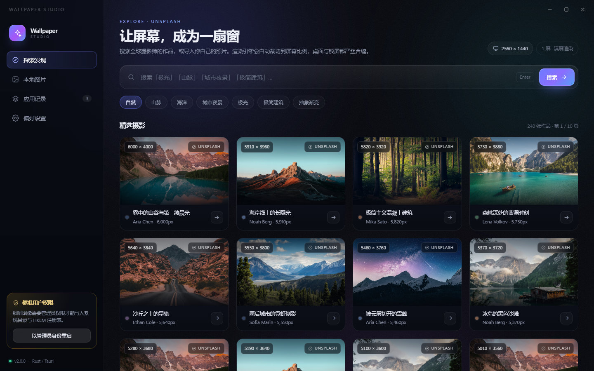

# Wallpaper Studio 2.0

Windows 桌面壁纸 + 锁屏图像工作台。Rust / Tauri 2 重构版：从 Unsplash 挑选摄影作品，或直接导入本机图片，一次性渲染成屏幕分辨率，同时应用到桌面壁纸和锁屏。



## 功能

- **探索 Unsplash**：关键词搜索、分类快捷入口、瀑布流分页加载，卡片直接预览。
- **本地图片**：文件选择或拖拽导入，支持 JPG / PNG / WEBP / BMP / GIF / TIFF，单张上限 160 MB。
- **一次成图，双端应用**：同一张成图可同时写入桌面壁纸与锁屏，风格统一。
- **像素级渲染**：按显示器原生分辨率输出，提供 6 种显示方式，成图不会出现黑边或变形。
  - 填充（满屏裁切）、氛围（模糊背景 + 完整主体）、适应（完整显示）、拉伸、居中、平铺。
- **应用前预览**：内置桌面/锁屏模拟，支持锁屏时钟预览；可多选应用目标。
- **应用记录**：保留最近成图与缩略图，可重新应用、打开文件位置或删除。
- **偏好设置**：Unsplash Access Key、默认显示方式、JPEG 画质、下载目录、历史保留、缓存清理。
- **权限自检**：检测管理员状态；锁屏写入受限时给出说明，并支持一键以管理员身份重启。

## 架构

```
ui/                         前端：原生 HTML + CSS + JS（无打包器，Tauri 直接内嵌）
  index.html                界面结构、内联 SVG 图标
  styles.css                Aurora 深色主题
  app.js                    状态管理、视图切换、命令调用
  samples/                  演示模式示例图片
src-tauri/
  src/main.rs               可执行入口
  src/lib.rs                Tauri 装配、命令注册
  src/commands.rs           搜索/下载/应用/历史/设置等命令与应用编排
  src/imaging.rs            渲染管线（6 种 fit 模式、预览、缩略图）+ 单元测试
  src/services/unsplash.rs  Unsplash 搜索、原图下载、下载追踪
  src/wallpaper.rs          SPI_SETDESKWALLPAPER + 桌面注册表
  src/lockscreen.rs         PersonalizationCSP 写入、LockApp 刷新、恢复默认
  src/sysinfo.rs            显示器信息、管理员检测、提权
  src/config.rs             设置与历史 JSON 持久化
  src/state.rs              运行期状态
  src/models.rs             前后端数据模型
  tauri.conf.json           窗口 1340×880、无边框、NSIS 打包配置
```

前端通过 `window.__TAURI__.core.invoke` 调用命令（`withGlobalTauri` 开启），不依赖 npm 运行时。

## 环境要求

- Windows 10 1809+ 或 Windows 11
- Rust 1.80+，MSVC 目标（安装 Visual Studio Build Tools 的「使用 C++ 的桌面开发」）
- WebView2 Runtime（Windows 11 自带；NSIS 安装包会自动下载引导程序）
- Node.js 18+（可选，仅用于生成安装包）

## 运行

```powershell
cd src-tauri
cargo run
```

首次编译需要下载并编译依赖，通常 3–5 分钟。

## 构建

```powershell
cd src-tauri
cargo build --release
```

产物：`src-tauri/target/release/wallpaper-studio.exe`（约 12 MB，运行仍需系统 WebView2）。

生成 NSIS 安装包：

```powershell
npm install
npm run build
```

安装包输出到 `src-tauri/target/release/bundle/nsis/`。

## 使用

1. **探索发现**：输入关键词或点击分类，点击任意卡片打开预览。
2. 选择显示方式，勾选「桌面壁纸」和/或「锁屏图像」，点击应用。
3. **本地图片**：拖入窗口，或按 `Ctrl + O` 选择文件；导入后同样进入预览。
4. **应用记录**：查看历史成图，重新应用或删除。
5. **偏好设置**：调整密钥、画质、默认显示方式与输出目录。

快捷键：`Ctrl + O` 本地图片，`Ctrl + F` 搜索，`Ctrl + 1~4` 切换页面，`Esc` 关闭预览。

## 锁屏与管理员权限

Windows 的锁屏图依赖注册表 `HKLM\SOFTWARE\Microsoft\Windows\CurrentVersion\PersonalizationCSP`，写入需要管理员权限：

- 标准用户：自动回退到 `HKCU`，部分系统（尤其 Windows 11 家庭版）可能不生效。
- 设置页提供「以管理员身份重启」，通过 `ShellExecuteW("runas")` 提权。
- 设置锁屏时会关闭 Windows 聚焦与锁屏幻灯片；「恢复默认锁屏」会清理相关键值。
- 锁屏图片会复制到 `C:\Windows\Web\Screen\wellmax-lockscreen.jpg`（需要管理员）；无权限时保留在应用图库中。

## 数据位置

| 内容 | 路径 |
| --- | --- |
| 设置 / 历史 | `%APPDATA%\trade.wxwellmax.wallpaperstudio\` |
| 原图与成图图库 | `%APPDATA%\trade.wxwellmax.wallpaperstudio\library\` |
| 缩略图 | `%APPDATA%\trade.wxwellmax.wallpaperstudio\thumbs\` |
| 预览/临时缓存 | `%LOCALAPPDATA%\trade.wxwellmax.wallpaperstudio\studio-cache\` |
| 默认导出目录 | `%USERPROFILE%\Pictures\Wallpapers\Wallpaper-Studio-<时间戳>.jpg` |

程序只读取本地图片，不会修改或移动原始文件。

## 旧版 Python 程序

仓库根目录中的 `wallpaperchanger.py`、`wallpaper_wx.py`、`.spec`、`build/`、`dist/` 等文件保持原样，可继续独立使用；新的 Rust 版本位于 `src-tauri/` 与 `ui/`。
